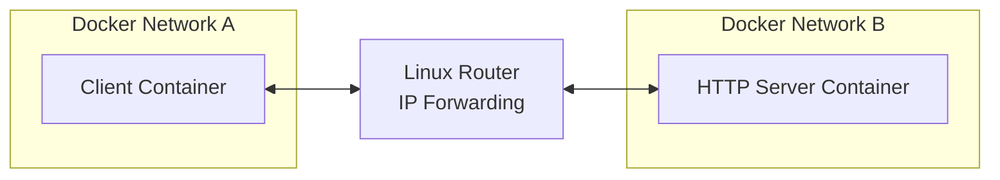
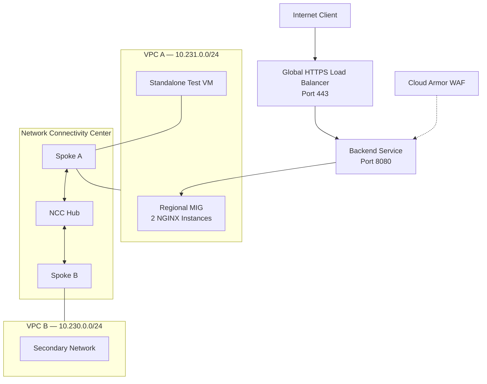
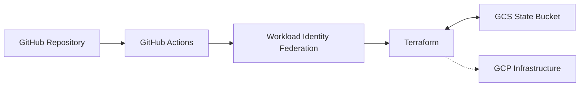

# Docker to GCP Infrastructure Migration

This project uses a local Docker environment as a simulated on-premises infrastructure baseline, then redesigns that environment using modern Google Cloud services and Terraform.

The original environment consists of two isolated Docker networks, a Linux routing appliance, an HTTP server, and a client communicating across the networks.

Rather than recreating those components individually in GCP, the migration focuses on preserving their core functionality while adopting a cloud-native architecture.

The GCP design uses Network Connectivity Center (NCC) for inter-VPC connectivity, regional Managed Instance Groups for application hosting, HTTPS load balancing, and Cloud Armor for application protection.

Terraform and GitHub Actions manage infrastructure provisioning and automation, with GCS providing remote state storage and Workload Identity Federation handling deployment authentication.

The diagrams below show the original Docker environment, the modernized GCP architecture, and the technical choices behind the design.

## 1. Original Environment — Local Docker

The Docker environment represents our on-premises infrastructure.

Two isolated Docker networks are connected through a Linux router. An HTTP server sits on one network, while a client on the other network communicates with it through the router.

This gives us a small environment where we can work with network isolation, routing, and application connectivity before moving the architecture into GCP.

## 2. Migrated Architecture — Google Cloud

In GCP, we recreate the two-network layout using custom VPCs.

Network Connectivity Center (NCC) connects the VPCs using a hub-and-spoke design. Firewall rules control traffic between networks.

The application side of the architecture uses a regional Managed Instance Group running NGINX, with traffic distributed through an external HTTPS load balancer.

## 3. Mapping Docker Components to GCP

| Local Docker environment | GCP implementation |
|---|---|
| Docker Network A | Custom VPC A |
| Docker Network B | Custom VPC B |
| Linux routing appliance | Network Connectivity Center hub and spokes |
| HTTP server container | NGINX instances managed through a MIG |
| Client container | Compute Engine VM for connectivity testing |
| Docker network isolation | VPC isolation and firewall rules |
| Container-to-container HTTP | Private VPC communication and load-balanced HTTP |
| Local application access | Global HTTPS load balancer with Cloud Armor |

The components aren't necessarily one-to-one replacements. Some Docker functions are handled by several GCP services, while other parts of the architecture change to use cloud-managed capabilities.

## 4. Architecture Decisions and Trade-offs

### Linux Router vs. Network Connectivity Center

The Docker environment uses a Linux routing appliance to connect two networks.

In GCP, we selected NCC to establish connectivity through a managed hub-and-spoke architecture.

VPC Peering would have been a simpler choice for two networks. NCC was selected because we wanted to work with a hub-and-spoke design and understand how route exchange operates between VPC spokes.

We also no longer manage the underlying Linux router ourselves.

### Docker HTTP Server vs. Managed Instance Group

The original HTTP server runs in a Docker container.

For the GCP implementation, we use NGINX running on Compute Engine instances created from a shared instance template.

The regional MIG maintains two instances and provides autohealing using health checks.

This changes how the application is hosted: rather than managing a single container, we're using managed VM infrastructure. The trade-off is additional infrastructure configuration and compute cost.

### Network Access vs. Load Balancing

In Docker, the client accesses the server across the local routed networks.

In GCP, the application also has an external entry point through a global HTTPS Application Load Balancer.

The load balancer forwards requests to the MIG backend on port 8080. Cloud Armor adds application-layer traffic filtering.

This is an extension of the original architecture rather than a direct replacement for the local router.

### Firewall Controls

The Docker environment demonstrates traffic flow between isolated networks through the Linux router.

GCP uses VPC firewall rules to control permitted traffic. We also configured ingress rules for Google's load balancer and health check systems.

Routing determines how traffic reaches another network; firewall rules determine whether that traffic is allowed.

### TLS Certificate

The lab uses a self-signed certificate rather than a purchased domain and publicly trusted certificate.

We originally managed the certificate through Terraform. After security scanning identified the risk of storing the private key in Terraform state, we moved certificate creation outside Terraform and referenced the existing GCP certificate through a data source.

## 5. Infrastructure Management

The GCP infrastructure is defined using Terraform, with resources separated into logical files for networking, NCC, compute, firewall rules, security, and load balancing.

Terraform state is stored in a dedicated GCS bucket with versioning and restricted access.

We also configured GitHub Actions to run Terraform using Workload Identity Federation rather than storing a long-lived GCP service account key in GitHub.

The GitHub Actions workflow handles Terraform formatting, validation, and planning. Deployment through the pipeline is kept separate from those checks.

The Docker environment provides the original network and application model. The GCP configuration shows how that same basic layout can be recreated using VPCs, managed networking, compute services, and infrastructure automation.
